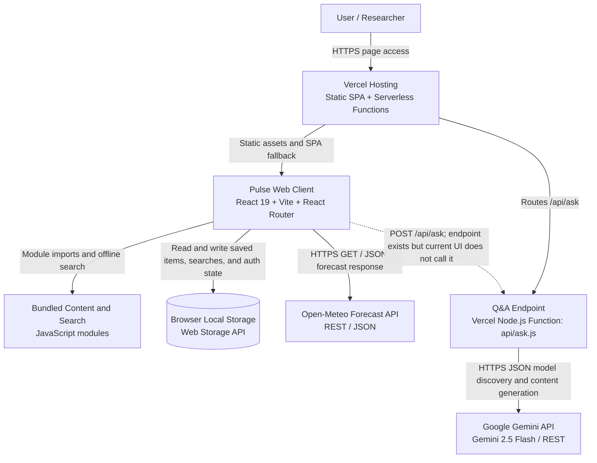

# Project Pulse

**SIH Problem Statement 26063** | **Team Null Hypothesis**

Project Pulse is a modern digital experience designed for discovery, learning, and engagement around environmental and research-driven data. This repository serves as the root workspace for the frontend client and the broader project ecosystem.

## Overview

This application presents a polished, responsive interface for:

- exploring data and insights
- browsing media and research content
- learning through curated educational sections
- navigating expedition-related experiences
- accessing a streamlined authentication flow

The current implementation is a React + Vite frontend focused on creating an immersive landing experience and content-driven product journey.

## System Architecture



The Explore page currently uses bundled offline search rather than calling `/api/ask`. The Q&A function is deployed separately and calls Gemini when invoked. No external database is configured; saved items, recent searches, bookings, and client auth state are stored in the user's browser.

## Tech Stack

- React 19
- Vite
- Tailwind CSS
- React Router DOM
- Framer Motion
- Lucide React

## Project Structure

```text
sih_pulse/
├── pulse_client/                # Frontend application
│   ├── public/
│   ├── src/
│   │   ├── api/
│   │   ├── assets/
│   │   ├── components/
│   │   │   ├── layout/
│   │   │   └── ui/
│   │   ├── data/
│   │   ├── features/
│   │   │   ├── auth/
│   │   │   ├── data-library/
│   │   │   ├── expeditions/
│   │   │   ├── explore/
│   │   │   ├── landing/
│   │   │   ├── learn/
│   │   │   └── media/
│   │   ├── router/
│   │   ├── store/
│   │   ├── utils/
│   │   ├── App.css
│   │   ├── App.jsx
│   │   ├── index.css
│   │   └── main.jsx
│   ├── package.json
│   ├── vite.config.js
│   ├── tailwind.config.js
│   └── README.md
├── README.md                   # Root project documentation
└── .gitignore
```

## Features

### Landing Experience
A visually rich landing page introduces the project with motion effects, structural storytelling, and clear product sections.

### Explore and Data Library
The app provides navigable sections for data discovery and information access, enabling users to browse curated datasets and research materials.

### Expeditions and Learn
Users can move through expedition-related modules and educational content designed for awareness, engagement, and knowledge building.

### Media Section
Dedicated media views help surface articles, visual content, and related storytelling assets.

### Authentication
A login route is included for user-facing access flows and future protected experiences.

## Getting Started

### Prerequisites

Make sure you have the following installed:

- Node.js 18+ recommended
- npm

### Installation

```bash
cd pulse_client
npm install
```

### Run in Development Mode

```bash
npm run dev
```

This starts the Vite development server. Open the local URL shown in the terminal to view the app.

### Production Build

```bash
npm run build
```

### Preview Build

```bash
npm run preview
```

## Scripts

```json
{
  "dev": "vite",
  "build": "vite build",
  "lint": "eslint .",
  "preview": "vite preview"
}
```

## Notes

- The root repository currently contains the frontend client under `pulse_client`.
- Additional backend, API, or database services can be added as the project evolves.
- Styling and layout are built around a modern, content-first experience using Tailwind CSS.

## Team

Project Pulse is developed by **Team Null Hypothesis** for the Smart India Hackathon (SIH).